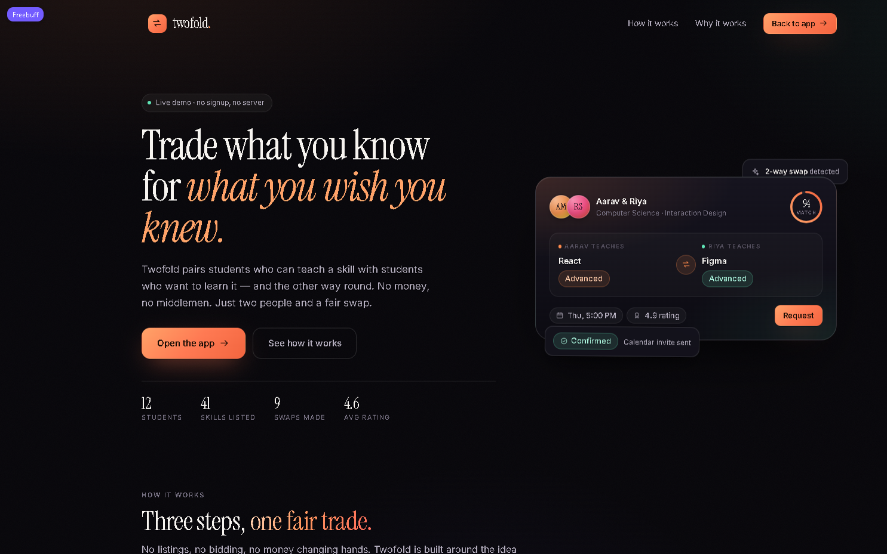
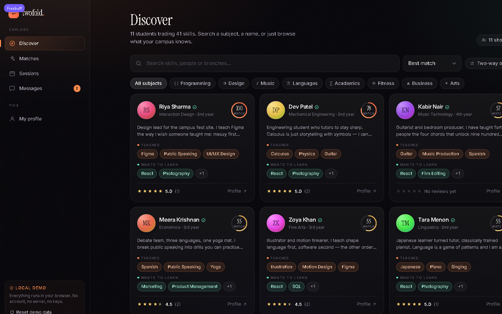
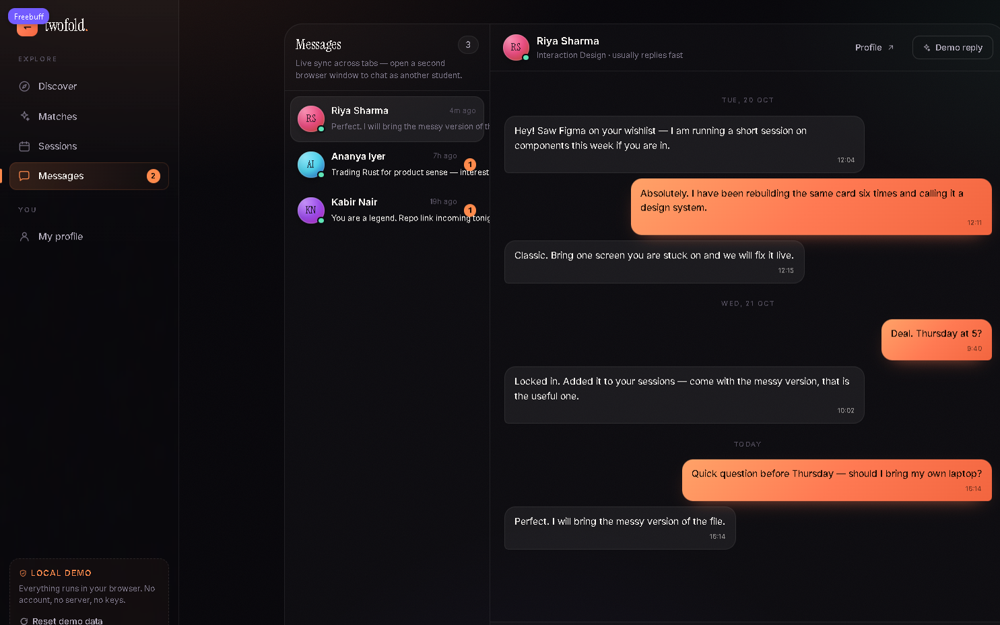
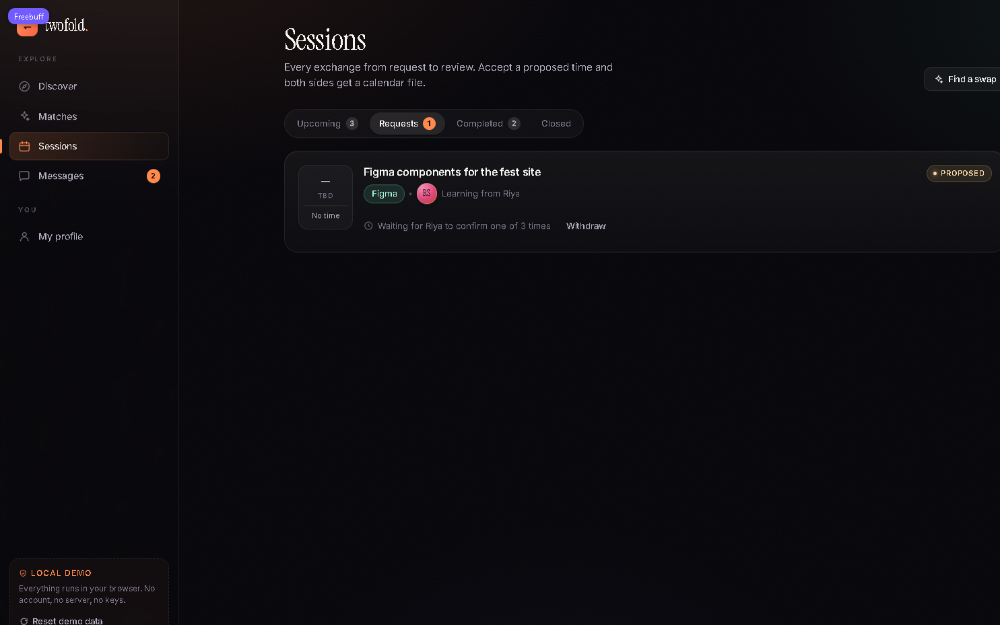

# Twofold

**A peer-to-peer skill exchange for students.** Teach what you know, learn what you don't — a fair two-way swap, no money involved.

Built for **Topic #03 · Peer-to-Peer Skill Exchange**: a marketplace-style web app connecting students who can teach a skill with students who want to learn it, with matching, chat, scheduling, calendar sync and reviews.



> **One command, one port.** Clone → `npm install` → `npm run dev`. Vite serves the React app and mounts its SQLite API in the same process; there are no API keys or separate services to configure.

---

## Quick start

```bash
npm install
npm run dev
```

Open **http://localhost:5173**.

Requires Node 20+. Nothing else — no Docker, no Postgres, no environment variables, and no separate migration step.

To check the production bundle:

```bash
npm run build && npm run preview
```

The preview server mounts the same API middleware as the development server.

The SQLite database is generated at `server/db/twofold.db` and reseeded when the server starts. To force a fresh seed, stop the server, run `npm run db:reset`, then restart it.

---

## The 5-minute demo

1. Open the app and hit **Enter the demo**.
2. Pick a student on the sign-in screen — **Aarav Mehta** is preselected and has the richest data. Every profile is fully populated.
3. **Discover** — search, filter by subject, toggle *Two-way only*, and watch match scores update.
4. **Matches** — see the ranking with a transparent score breakdown per student.
5. Open a match → **Request session** → choose a skill, topic and up to three time slots → **Send request**.
6. **Sessions → Requests** — accept a proposed time (this generates a calendar-ready `.ics`), or withdraw a request you sent.
7. **Messages** — send a message. The **Demo reply** button in the conversation header sends a sample reply as the other student, so a single-window demo still feels alive.
8. **Completed → Leave a review** — rate a finished session; the review appears on that student's public profile and feeds back into matching.
9. **My profile** — edit your skills, levels and availability, then check how your matches change.

### Try the cross-tab sync

Open a **second browser tab**, sign in as **Riya Sharma**, and keep Aarav in the first tab. Send a message from either side — it appears in the other tab within about a second. Each tab polls the same local API for an updated database snapshot. Chat and session requests are stored in SQLite and shared by every browser connected to this server.

### Demo accounts

| Student | Branch | Teaches | Wants to learn |
|---|---|---|---|
| Aarav Mehta | Computer Science | React, Product Management, Photography | Public Speaking, Figma, Guitar |
| Riya Sharma | Interaction Design | Figma, Public Speaking, UI/UX | React, Photography, Marketing |
| Ananya Iyer | Computer Science | Rust, Python, Machine Learning | Product Management, Figma |
| Kabir Nair | Music Technology | Guitar, Music Production, Spanish | React, Film Editing |
| Meera Krishnan | Economics | Spanish, Public Speaking, Yoga | Marketing, Product Management |
| Zoya Khan | Fine Arts | Illustration, Motion Design, Figma | React, SQL |

Six more students are seeded and browsable from **Discover**. Pick another identity later from the sign-in screen, or click **Reset demo data** in the sidebar to restore the whole dataset.

---

## Deliverables, and where they live

| Brief requirement | Implementation |
|---|---|
| Deployed web app where students create and browse skill profiles | `src/pages/Discover.tsx`, `src/pages/Profile.tsx`, `src/pages/MyProfile.tsx` |
| Working matching engine | `src/lib/matching.ts` — weighted, explainable, pure |
| Functional in-app chat | `src/pages/Chat.tsx` — two-pane, persisted, live across tabs |
| Scheduling module that syncs confirmed sessions to a calendar | `src/lib/ics.ts` — generates a real `.ics` (Google/Apple/Outlook) |
| Live ratings and reviews visible on each profile | `src/components/ReviewModal.tsx`, `src/pages/Profile.tsx` |
| Documented database schema and API | [`docs/DATA_MODEL.md`](docs/DATA_MODEL.md), [`docs/API.md`](docs/API.md) |
| Live demo: one real match from search → scheduled session | The seeded sessions cover every state, plus a full request/accept flow you can drive yourself |
| Search and category filters | `src/pages/Discover.tsx` — free text + 8 subject categories + sort |





---

## The matching engine

Every candidate is scored out of 100 on four signals (`src/lib/matching.ts`):

| Signal | Weight | What it measures |
|---|---|---|
| **Learn** | 45 | How many of *their* teachable skills are on *your* wishlist |
| **Reciprocity** | 35 | How many of *your* teachable skills are on *their* wishlist |
| **Affinity** | 12 | Shared subject areas, so adjacent interests surface too |
| **Trust** | 8 | Their review history (new students get a neutral 60%) |

Learn and reciprocity saturate at two skills, so one perfect overlap already scores well. The engine is a pure function — same inputs, same score — and every card shows its own breakdown, so the number is never a black box.

## Calendar sync

A confirmed session exports a standards-compliant `VCALENDAR` file with `DTSTART`/`DTEND`, a 30-minute display alarm, organiser and attendee. It imports cleanly into Google Calendar, Apple Calendar and Outlook. No OAuth, no API credentials, works offline.



---

## Architecture

```
.
├── index.html                 # Single entry point
├── package.json
├── vite.config.ts
├── tsconfig.json
├── README.md
├── skill.md                   # Persistent project context (see below)
├── docs/
│   ├── DATA_MODEL.md          # Entity schema + storage layout
│   └── API.md                 # Data API reference
├── screenshots/
└── src/
    ├── main.tsx               # Fonts, styles, providers, router
    ├── App.tsx                # Routes + auth guard
    ├── components/            # 15 reusable UI pieces
    │   ├── AppShell.tsx       # Sidebar + mobile tab bar
    │   ├── Avatar.tsx         # Deterministic gradient avatars
    │   ├── MatchCard.tsx      # Match card with score breakdown
    │   ├── MatchRing.tsx      # Animated score dial
    │   ├── SessionCard.tsx    # Session lifecycle + actions
    │   ├── RequestSessionModal.tsx
    │   ├── ReviewModal.tsx
    │   ├── PersonCard.tsx, SkillChip.tsx, Rating.tsx
    │   ├── Modal.tsx, Toast.tsx, Reveal.tsx, EmptyState.tsx
    │   └── icons.tsx          # Hand-rolled 24px icon set
    ├── context/
    │   └── AppContext.tsx     # useSyncExternalStore over the store
    ├── data/
    │   ├── types.ts           # Domain entities
    │   ├── catalog.ts         # 41 skills across 8 categories
    │   ├── store.ts           # HTTP snapshot bus + 1-second polling
    │   └── api.ts             # The only data access surface
    ├── lib/
    │   ├── matching.ts        # Scoring engine
    │   ├── ics.ts             # iCalendar writer
    │   ├── format.ts          # Date / text formatting
    │   └── id.ts
    ├── pages/
    │   ├── Landing.tsx, Auth.tsx
    │   ├── Discover.tsx, Matches.tsx
    │   ├── Profile.tsx, MyProfile.tsx
    │   ├── Sessions.tsx, Chat.tsx
    └── styles/
        ├── tokens.css         # Design tokens, reset, typography
        ├── layout.css         # Shell, sidebar, grids
        ├── components.css     # Buttons, inputs, cards, modal…
        └── pages.css          # Page-specific composition
server/
├── api.ts                      # Connect-style JSON API
├── db.ts                       # SQLite open, schema, seed and reset
├── queries.ts                  # Prepared raw SQL queries
├── seed.ts                     # Demo data and relative timestamps
├── vite-plugin.ts              # API middleware for dev and preview
└── db/schema.sql               # Committed SQLite schema (database file is generated)
```

**Data flow:** components → `src/data/api.ts` → `src/data/store.ts` → `/api/*` on the same Vite server → `server/api.ts` → prepared SQL in `server/queries.ts` → SQLite. The client loads a full snapshot and polls once per second; successful mutations return a fresh snapshot so the writing tab updates immediately. React subscribes through `useSyncExternalStore`.

**Runtime setup:** Vite hosts both the frontend and API in one process on one port, in development and preview. The ignored SQLite file is created from `server/db/schema.sql` and reseeded on every server boot; demo dates are generated in JavaScript relative to startup. `npm run db:reset` removes the database so it can be recreated on the next boot, and the in-app Reset demo data action restores the seed without a restart. `better-sqlite3` is pinned to **12.2.0** because v13 dropped the Node 20 prebuilt binary needed for a reliable install on the judging environment.

## Tech stack

- **React 18** + **TypeScript** (strict) + **Vite 5**
- **React Router 6** for client-side routing
- **Plain CSS** with a token layer — no utility framework, no CSS-in-JS runtime
- **Self-hosted fonts** via `@fontsource` (Inter + Instrument Serif) — no network requests at runtime
- **SQLite backend:** raw SQL through `better-sqlite3` 12.2.0; no ORM, generated client, or separate server process.

## Design notes

- **Warm-on-ink palette:** near-black canvas with an ember accent for *what you teach* and mint for *what you want to learn*. The colour pairing carries meaning everywhere it appears.
- **Editorial typography:** Instrument Serif for display, Inter for interface text, tight tracking on headlines.
- Custom icon set drawn on a single 24px grid at 1.6px stroke for consistency.
- Motion is used sparingly: scroll reveals, hover lifts, a drifting hero panel, animated score rings — all disabled under `prefers-reduced-motion`.
- Responsive from 360px up: sidebar becomes a bottom tab bar, chat collapses to a single pane, grids reflow.

## Scripts

| Command | Purpose |
|---|---|
| `npm run dev` | Dev server on port 5173 |
| `npm run build` | Typecheck + production build to `dist/` |
| `npm run preview` | Serve the production build |
| `npm run typecheck` | TypeScript only |

## Notes and limitations

- **Demo backend:** state lives in the local SQLite file on the machine running Vite. Browsers connected to that server share the same data; the app does not provision a hosted database.
- **No real authentication.** Signing in selects one of the seeded students; it is a demo identity switch, not a login system.
- **Chat polls the local API.** Data is stored in SQLite, and open tabs refresh within about one second. The *Demo reply* button is an explicitly labelled demo affordance, not a bot.
- Seed timestamps are generated relative to server startup, so entries such as "in 3 days" stay current after a fresh run. Restarting the server restores the demo seed.

## Project context

[`skill.md`](skill.md) is the persistent memory file for this project — architecture decisions, conventions, progress and next steps. Read it first if you are picking this up with fresh context.
